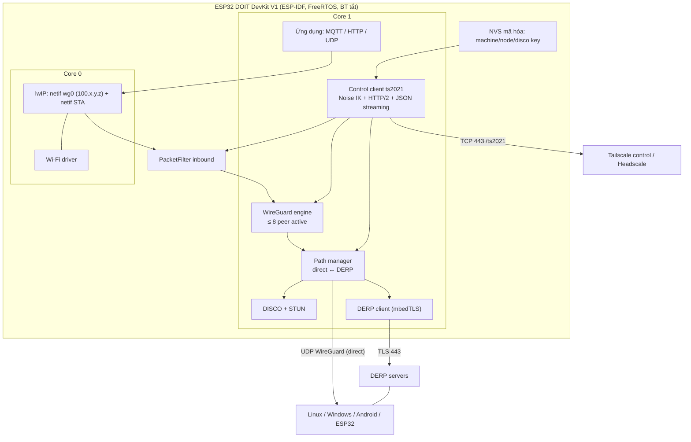
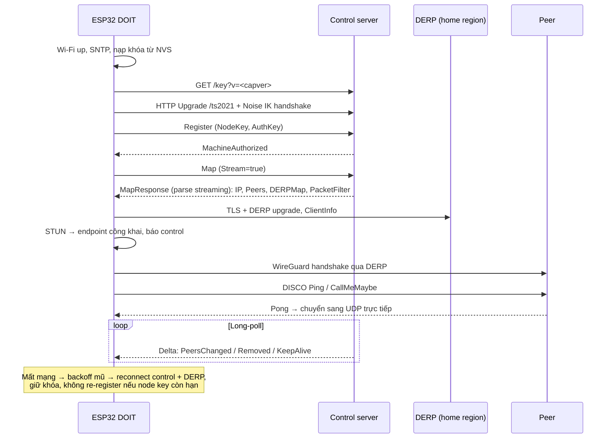

# Phase 1 — Technical Feasibility Report
## Tailscale-compatible Networking trên ESP32 DOIT DevKit V1

- **Phiên bản:** 0.2 (bản nghiên cứu, chưa có số đo trên phần cứng)
- **Ngày:** 2026-11-23
- **Nền tảng mục tiêu:** **ESP32 DOIT DevKit V1** (`esp32doit-devkit-v1`)
- **Thay đổi so với v0.1:** loại ESP8266 khỏi phạm vi; mọi phân tích tài nguyên dựa trên ESP32-WROOM-32 **không PSRAM, 4 MB flash**.

### Quy ước độ tin cậy

| Ký hiệu | Ý nghĩa |
|---|---|
| **[V]** | Đã xác minh từ tài liệu/mã nguồn chính thức (Tailscale, WireGuard, Espressif) |
| **[S]** | Số liệu tự công bố bởi dự án bên thứ ba, chưa kiểm chứng độc lập |
| **[E]** | Ước lượng kỹ thuật của nhóm, **bắt buộc đo lại** ở Phase 2–4 |

---

## 0. Tóm tắt điều hành

| Câu hỏi | Kết luận |
|---|---|
| DOIT DevKit V1 chạy được Tailscale chính thức (tailscaled)? | **Không.** tailscaled viết bằng Go, cần OS đầy đủ và hàng chục MB RAM. |
| DOIT DevKit V1 chạy được **client Tailscale-compatible**? | **Có, có điều kiện.** MicroLink đã chạy trên ESP32-WROOM-32D DevKitC (cùng module/chip, không PSRAM) với ~140 KB SRAM, tối đa 8 tunnel đồng thời, tailnet ~30 peer **[S]**. |
| Điều kiện | Netmap nhỏ (giới hạn bằng ACL), ≤ 8 peer hoạt động, tắt Bluetooth, tối ưu mbedTLS, bảng phân vùng flash tùy chỉnh. |
| Coordination server chính thức? | **Có về kỹ thuật** (ts2021); client không chính thức → rủi ro thay đổi giao thức. Headscale làm môi trường test. |
| Cần Linux Gateway? | **Không.** |
| **Go / No-Go** | **GO có điều kiện** cho DOIT DevKit V1. |

**Về ESP8266:** ESP8266 không thể làm *Tailscale node trực tiếp* (thiếu RAM: cần ~100–130 KB, chỉ có ~40–50 KB trống). Nó chỉ dùng được dưới dạng WireGuard thuần sau một gateway. Theo yêu cầu, **ESP8266 bị loại khỏi phạm vi dự án**.

---

## 1. Phần cứng mục tiêu: ESP32 DOIT DevKit V1

| Thông số | Giá trị | Ghi chú cho dự án |
|---|---|---|
| Module | ESP32-WROOM-32 | Một số lô dùng chip ESP32-D0WDQ6 (rev 1), lô mới dùng ESP32-D0WD-V3 (rev 3) |
| CPU | 2× Xtensa LX6, tối đa 240 MHz | Core 0: Wi‑Fi/lwIP; Core 1: Tailscale + crypto |
| SRAM | 520 KB (DRAM dùng được cho heap ~300 KB) | Heap chia thành nhiều vùng ⇒ **block liền kề lớn nhất ~100–110 KB [E]** |
| Heap trống sau khi Wi‑Fi STA kết nối **[E]** | ~180–230 KB | Phải đo ở Phase 2 |
| PSRAM | **Không có** | Không dùng được cấu hình buffer 512 KB của MicroLink |
| Flash | 4 MB QSPI | Firmware ~0.8–1 MB ⇒ đủ cho 2 phân vùng OTA |
| Crypto HW | AES, SHA, RSA/bignum, TRNG | **Không** tăng tốc ChaCha20/Poly1305/X25519/BLAKE2s ⇒ chạy phần mềm |
| USB-UART | CP2102 (hoặc CH340 tùy lô) | |
| Nguồn | LDO AMS1117 3.3 V, LED nguồn | Board tiêu thụ nền vài mA ⇒ **không dùng để đo deep-sleep** |
| Bluetooth | BT/BLE | **Tắt hoàn toàn** và giải phóng bộ nhớ BT (`esp_bt_mem_release`) để lấy thêm RAM |

**Việc đầu tiên khi nhận board:** chạy `esptool.py chip_id` / log boot để xác định **chip revision**:
- **rev 3 (ECO3):** hỗ trợ **Secure Boot V2** + Flash Encryption → dùng được cho sản phẩm.
- **rev 0/1:** chỉ có Secure Boot V1 → chấp nhận được cho nghiên cứu, không khuyến nghị cho sản phẩm.

---

## 2. Phân tích kiến trúc Tailscale

### 2.1. "WireGuard-compatible" khác "Tailscale-compatible"

Node Tailscale chỉ chấp nhận WireGuard peer do **control server** phân phối qua netmap. Thiết bị chạy WireGuard thuần, cấu hình tay, **không thể** nói chuyện trực tiếp với node Tailscale **[V]**. Một Tailscale node cần:

1. **Control client (ts2021):** HTTP/1.1 Upgrade `/ts2021` → Noise IK (`Noise_IK_25519_ChaChaPoly_BLAKE2s`) → HTTP/2 bên trong; Register + Map long-poll **[V]**.
2. **WireGuard data plane:** node key là WireGuard static key; peer động theo netmap.
3. **DERP client:** relay qua TLS/TCP 443.
4. **DISCO + STUN:** khám phá endpoint, NAT traversal.
5. **Packet filter:** áp ACL/Grants tại node nhận.

### 2.2. Thành phần và cách xử lý trên DOIT DevKit V1

| Thành phần | Bắt buộc? | Xử lý |
|---|---|---|
| Control Plane (ts2021) | **Bắt buộc** | Noise IK + HTTP/2 tối giản; không yêu cầu nén zstd |
| Device Authentication | **Bắt buộc** | Chỉ **pre-auth key có tag** |
| Node Identity (machine/node/disco key, Curve25519) | **Bắt buộc** | Sinh trên thiết bị, lưu NVS mã hóa |
| Key Management | **Bắt buộc** (tối thiểu) | Tagged device (mặc định tắt key expiry) + re-register khi cần |
| WireGuard | **Bắt buộc** | `wireguard-lwip`, tối đa 8 peer active (LRU) |
| Peer Discovery | **Bắt buộc** | **Streaming JSON parser** (không có PSRAM để buffer cả netmap) |
| DERP Relay | **Bắt buộc trong thực tế** | Một kết nối tới home region; failover sang region khác |
| NAT Traversal (STUN + DISCO) | Giản lược được | Phase 3: chỉ DERP; Phase 4: thêm DISCO/STUN |
| ACL / Grants | Phía node nên có | PacketFilter rút gọn (IP/proto/port) cho inbound |
| IP Address Management | **Bắt buộc** | Gán 100.x.y.z cho netif `wg0` trên lwIP |
| MagicDNS | Tùy chọn | Tra cứu cục bộ từ netmap |
| Taildrop, SSH, Funnel/Serve, exit node, subnet router | **Không** | Loại bỏ |

> **Lưu ý bảo mật:** ACL Tailscale được thực thi tại node nhận. Nếu MCU bỏ qua `PacketFilter`, mọi peer thấy MCU trong netmap đều gửi gói vào được. → Bắt buộc có filter inbound.

---

## 3. Đánh giá thư viện

| Thư viện | Giấy phép | Phù hợp DOIT DevKit V1? | Đánh giá |
|---|---|---|---|
| **MicroLink** (`CamM2325/microlink`, fork `espkvm/microlink`) | MIT **[V]** | **Có** — đã test trên ESP32-WROOM-32D DevKitC và HiLetgo ESP-32S (không PSRAM) **[S]** | ts2021, HTTP/2 tự viết, DERP, DISCO, STUN, MagicDNS cục bộ, delta map. Nhưng: dùng **cJSON DOM** (tốn 2–3× kích thước JSON) và buffer toàn bộ MapResponse ⇒ là nút thắt RAM trên board không PSRAM. Cộng đồng nhỏ (3 sao, commit cuối 2026-03-17), không CI, chưa thấy PacketFilter **[S]** |
| **TailTiny** (fork MicroLink) | theo MicroLink | Có thể | Sửa lỗi, cấu hình dễ hơn **[S]** |
| **trombik/esp_wireguard** | BSD-3-Clause **[V]** | **Có** (ESP-IDF, target esp32) | Lõi WireGuard cho Phase 2; stack 5 KB cho tcpip & main task là đủ trên ESP32-D0WD-V3 **[S]** |
| **smartalock/wireguard-lwip** | BSD-3-Clause | Có | Lõi chung của các port |
| **tailscale/tailscale** (Go) | BSD-3-Clause | — | Tham chiếu chuẩn: `tailcfg`, `controlbase`, `derp`, `disco` |
| **tailscale/tailscale-rs** | BSD-3-Clause **[V]** | Không (std + tokio, WIP) | Tài liệu kiến trúc thứ hai |
| **Headscale** | BSD-3-Clause | — | Control server cho test |
| ESP-IDF v5.3+, lwIP, mbedTLS | Apache-2.0 / BSD / Apache-2.0 | Có | Nền tảng |
| JSON streaming: **jsmn** (MIT) hoặc parser SAX tự viết | MIT | Có | Thay cJSON DOM cho MapResponse |
| Monocypher (tùy chọn) | CC0 / BSD-2 | Có | X25519/ChaCha20-Poly1305/BLAKE2s gọn, nhanh |

**Khuyến nghị:** fork MicroLink làm baseline; thay phần parse MapResponse bằng streaming parser; bổ sung PacketFilter; audit crypto/parser.

> **Framework:** dùng **ESP-IDF** (không dùng Arduino/PlatformIO-Arduino) để kiểm soát Kconfig, bảng phân vùng, mbedTLS và giải phóng bộ nhớ BT. PlatformIO với `board = esp32doit-devkit-v1`, `framework = espidf` là chấp nhận được.

---

## 4. Ngân sách tài nguyên trên DOIT DevKit V1

### 4.1. RAM **[E]** (đối chiếu số MicroLink **[S]** ~140 KB tổng khi không PSRAM)

| Khối | Cấu hình MicroLink không PSRAM | Mục tiêu tối ưu (Phase 4) |
|---|---|---|
| Buffer HTTP/2 nhận MapResponse | 64 KB | 8–16 KB (streaming) |
| Buffer JSON / cây cJSON | 64 KB (cấp phát tạm khi poll) | 4–8 KB (streaming) |
| mbedTLS (DERP + HTTPS `/key`) | ~35–40 KB | ~20–25 KB (dynamic buffer + asymmetric in 16 KB / out 4 KB) |
| Noise + HTTP/2 state | ~10–15 KB | ~10 KB |
| WireGuard (8 peer × ~200 B + buffer gói) | ~8–10 KB | ~6–8 KB |
| DERP + DISCO + STUN | ~6–10 KB | ~6 KB |
| Stack các task | ~42 KB **[S]** | ~30 KB (đo high-water mark rồi cắt) |
| **Đỉnh phần Tailscale** | **~140 KB [S]** | **~80–100 KB [E]** |
| **Còn lại cho ứng dụng** (heap trống ~180–230 KB) | **~40–90 KB** | **~80–150 KB** |

Rủi ro chính trên chip này **không phải tổng RAM mà là phân mảnh**: buffer 64 KB cần block liền kề; sau vài giờ chạy, block lớn nhất có thể nhỏ hơn 64 KB → poll netmap thất bại. Streaming parser loại bỏ rủi ro này.

### 4.2. Giới hạn kích thước tailnet

| Cấu hình | Số peer trong netmap | Peer hoạt động đồng thời |
|---|---|---|
| MicroLink, buffer 64 KB | ~30 **[S]** | 8 |
| Streaming parser + bảng peer gọn (~64 B/peer metadata) | ~100–200 **[E]** | 8 |
| **Khuyến nghị vận hành** | **Giới hạn bằng ACL** để MCU chỉ "thấy" 2–10 peer cần thiết | 4–8 |

### 4.3. Bảng phân vùng flash 4 MB đề xuất

| Tên | Loại | Offset | Kích thước |
|---|---|---|---|
| (bootloader + partition table) | — | 0x0000 | 36 KB |
| nvs | data/nvs | 0x9000 | 24 KB |
| nvs_keys | data/nvs_keys | 0xF000 | 4 KB |
| otadata | data/ota | 0x10000 | 8 KB |
| phy_init | data/phy | 0x12000 | 4 KB |
| ota_0 | app | 0x20000 | 1.875 MB |
| ota_1 | app | 0x200000 | 1.875 MB |
| coredump | data/coredump | 0x3E0000 | 64 KB |

Firmware dự kiến 0.8–1 MB (MicroLink: 758–950 KB trên S3 **[S]**) ⇒ dư ~0.9 MB mỗi phân vùng.

### 4.4. CPU và throughput **[E]**

| Đường | Throughput | RTT |
|---|---|---|
| Direct UDP (WireGuard) | 1–4 Mbit/s (LX6 chậm hơn S3 một chút) | 5–50 ms (MicroLink, Wi‑Fi **[S]**) |
| Qua DERP | 0.3–1.5 Mbit/s | 30–150 ms **[S]** |
| Kết nối từ boot | ~15–20 s qua Wi‑Fi **[S]** | — |

Nút thắt: ChaCha20-Poly1305 phần mềm và copy buffer lwIP. Dùng core 1 cho crypto, chạy CPU 240 MHz. Với ứng dụng IoT (MQTT, telemetry, điều khiển) mức này là đủ.

### 4.5. Điện năng **[E]**

| Trạng thái | Dòng (module) | Ghi chú |
|---|---|---|
| Wi‑Fi TX/RX liên tục | 100–240 mA | |
| Online, modem-sleep (DTIM) | 20–40 mA trung bình | Keepalive DERP/WG/long-poll đánh thức radio định kỳ |
| Deep sleep | ~10 µA (module) — **nhưng board DOIT tốn vài mA** do LDO, LED, CP2102 | Không thể giữ "online" khi deep sleep |

Kết luận: DOIT DevKit V1 phù hợp thiết bị **cắm điện**. Đo điện năng chính xác cần đo tại chân 3V3 của module (bỏ qua LDO/USB) hoặc dùng board tối giản ở giai đoạn sau.

---

## 5. Trả lời 10 câu hỏi của dự án (trên DOIT DevKit V1)

| # | Câu hỏi | Trả lời |
|---|---|---|
| 1 | Chạy Tailscale trực tiếp trên ESP32? | tailscaled: **Không**. Client tương thích viết bằng C: **Có** (bằng chứng: MicroLink trên WROOM-32 không PSRAM **[S]**, cần tự xác nhận ở Phase 3). |
| 2 | ESP8266? | **Loại khỏi phạm vi** (không đủ RAM để làm Tailscale node trực tiếp). |
| 3 | Dùng coordination server chính thức? | **Có về kỹ thuật**; rủi ro thay đổi capability version; rà soát ToS; Headscale làm dự phòng. |
| 4 | Không cần Linux Gateway? | **Có** — mọi thành phần chạy trên board. |
| 5 | Thành phần tự phát triển | Xem mục 6. |
| 6 | RAM/Flash tối thiểu | RAM: ~140 KB **[S]** (hiện tại), mục tiêu 80–100 KB **[E]**. Flash: ~1 MB/firmware, **4 MB** tổng là đủ với OTA. |
| 7 | Throughput | Direct 1–4 Mbit/s, DERP 0.3–1.5 Mbit/s **[E]**. |
| 8 | Giao tiếp với Tailscale node thường? | **Có** ở tầng IP (ICMP/UDP/TCP): Linux, Windows, Android, MCU khác. Không có Taildrop/SSH/Funnel/exit node. |
| 9 | Hạn chế không khắc phục được | Không PSRAM ⇒ trần số peer; không giữ online khi deep sleep; throughput vài Mbit/s; phụ thuộc giao thức Tailscale (cần OTA); symmetric NAT hai phía ⇒ chỉ DERP; chip rev 1 không có Secure Boot V2; khóa lưu trong flash (giảm thiểu bằng Flash Encryption + NVS Encryption). |
| 10 | Kiến trúc tối ưu | Native client trên board, netmap tối thiểu qua ACL, streaming parse, ≤ 8 peer active — mục 7. |

---

## 6. Thành phần cần phát triển / hoàn thiện

(Với MicroLink làm baseline: **A** = audit & giữ, **M** = sửa đổi, **N** = viết mới.)

| # | Thành phần | Trạng thái |
|---|---|---|
| 1 | Noise IK control transport + HTTP Upgrade | A |
| 2 | HTTP/2 client tối giản | A + M (giảm buffer nhận, xử lý flow-control theo chunk) |
| 3 | Register / Map long-poll / delta update | A |
| 4 | **Streaming JSON parser cho MapResponse** | **N** (thay cJSON DOM) |
| 5 | Key store NVS mã hóa + re-register | M |
| 6 | WireGuard đa peer động, LRU | A |
| 7 | DERP client | A + M (mbedTLS dynamic buffer) |
| 8 | DISCO + STUN | A |
| 9 | Path selection direct ↔ DERP | A |
| 10 | **PacketFilter inbound** | **N** |
| 11 | Reconnect state machine, watchdog, OTA, coredump | M/N |
| 12 | Harness đo tài nguyên & test tự động với Headscale | **N** |

---

## 7. Kiến trúc đề xuất

### 7.1. Kiến trúc firmware



### 7.2. Cấu hình tailnet

- Thiết bị đăng ký bằng **pre-auth key có tag** `tag:iot` (tagged device mặc định tắt key expiry).
- ACL/Grants: chỉ `tag:server` (và thiết bị quản trị) ↔ `tag:iot` trên port cần thiết; `tag:iot` không thấy phần còn lại của tailnet.
  ⇒ Netmap của MCU chỉ chứa vài peer — **đây là tối ưu RAM hiệu quả nhất** trên board không PSRAM.

### 7.3. Luồng kết nối



### 7.4. Kconfig khởi điểm (cần tinh chỉnh theo số đo)

```
CONFIG_ESP_DEFAULT_CPU_FREQ_MHZ_240=y
CONFIG_BT_ENABLED=n
CONFIG_MBEDTLS_DYNAMIC_BUFFER=y
CONFIG_MBEDTLS_ASYMMETRIC_CONTENT_LEN=y
CONFIG_MBEDTLS_SSL_IN_CONTENT_LEN=16384
CONFIG_MBEDTLS_SSL_OUT_CONTENT_LEN=4096
CONFIG_ESP_TLS_USING_MBEDTLS=y
CONFIG_MBEDTLS_CERTIFICATE_BUNDLE=y
CONFIG_PARTITION_TABLE_CUSTOM=y
CONFIG_ESP_TASK_WDT_EN=y
CONFIG_ESP_COREDUMP_ENABLE_TO_FLASH=y
CONFIG_NVS_ENCRYPTION=y            # cùng Flash Encryption khi lên sản phẩm
# MicroLink (khi chưa có streaming parser)
CONFIG_ML_H2_BUFFER_SIZE_KB=64
CONFIG_ML_JSON_BUFFER_SIZE_KB=64
CONFIG_ML_MAX_PEERS=8
```

---

## 8. Kế hoạch phát triển (đã bỏ phase ESP8266)

| Phase | Thời lượng **[E]** | Công việc | Hoàn thành khi |
|---|---|---|---|
| 1. Feasibility | xong | Tài liệu này | Được duyệt |
| 2. WireGuard PoC | 2–3 tuần | `esp_wireguard` trên DOIT ↔ `wg` Linux; harness đo: `idf.py size`, `esp_get_free_heap_size`, `heap_caps_get_largest_free_block`, `uxTaskGetStackHighWaterMark`, `vTaskGetRunTimeStats`, iperf UDP/TCP qua tunnel, dòng điện (INA219 tại 3V3) | Có số đo thật thay cho các mục **[E]** ở 4.1, 4.4, 4.5 |
| 3. Tailscale Integration | 4–6 tuần | Fork MicroLink, build cho `esp32` với cấu hình không PSRAM; test với Headscale (cố định phiên bản) rồi Tailscale chính thức; thêm PacketFilter | Test 1–4 ở mục 9 đạt |
| 4. Optimization | 3–4 tuần | Streaming JSON parser, mbedTLS tuning, reconnect state machine, soak test 72 h, đo phân mảnh heap | Đỉnh RAM ≤ 100 KB; test 5–10 đạt |

---

## 9. Ma trận kiểm thử

| # | Kịch bản | Cách thực hiện | Đo |
|---|---|---|---|
| 1 | Tham gia Tailnet | Auth key có tag; `tailscale status` | Thời gian boot→online |
| 2–4 | Linux / Windows / Android | `tailscale ping`, `ping`, iperf3/UDP echo, MQTT | RTT, throughput, loss |
| 5 | ESP32 ↔ ESP32 | 2 board DOIT, UDP echo | RTT, đường direct/DERP |
| 6 | NAT khác nhau | Một node sau 4G CGNAT, một sau router gia đình | Có lên direct không |
| 7 | Ép DERP | Chặn UDP outbound | Throughput DERP |
| 8 | Mất Internet | Ngắt WAN 30 s / 5 phút / 1 giờ | Thời gian phục hồi |
| 9 | Soak test | 72 h, ping mỗi 10 s | Uptime, heap min, **largest free block**, số reboot |
| 10 | Giới hạn tài nguyên | Netmap 5 / 30 / 100 peer | Heap low-watermark, lỗi parse |

---

## 10. Rủi ro kỹ thuật

| Rủi ro | Mức | Giảm thiểu |
|---|---|---|
| Phân mảnh heap làm hỏng buffer 64 KB sau thời gian dài | **Cao** | Streaming parser; pool buffer cấp phát tĩnh lúc boot |
| Tailscale đổi control protocol / capability version | Cao | Theo dõi release; OTA; Headscale cố định phiên bản |
| Baseline MicroLink ít người duy trì, chưa audit | Cao | Fork, review crypto/parser, fuzz JSON & DERP frame |
| Thiếu PacketFilter → MCU mở với mọi peer | Cao | Triển khai filter; ACL chặt theo tag |
| Netmap lớn vượt RAM | Trung bình | Giới hạn visibility bằng ACL |
| Chip rev 1 không có Secure Boot V2 | Trung bình | Kiểm tra revision; dùng lô rev 3 cho sản phẩm |
| Rò rỉ khóa từ flash | Trung bình | Flash Encryption + NVS Encryption |
| Điều khoản sử dụng với client không chính thức | Trung bình | Rà soát ToS trước khi thương mại hóa |
| Đồng hồ sai (TLS) | Thấp | SNTP trước khi kết nối |
| Board DOIT không phù hợp đo điện năng | Thấp | Đo tại 3V3 module, ghi rõ phương pháp |

---

## 11. Kết luận Go / No-Go

| Nền tảng | Kết luận | Điều kiện |
|---|---|---|
| **ESP32 DOIT DevKit V1** (WROOM-32, không PSRAM, 4 MB flash) | **GO có điều kiện** | Netmap giới hạn bằng ACL (≤ ~30 peer với baseline, cao hơn khi có streaming parser), ≤ 8 peer active, BT tắt, thiết bị cắm điện |
| ESP8266 | **Ngoài phạm vi** | — |

**Câu hỏi mở Phase 2 phải trả lời bằng đo đạc:** heap trống và block liền kề lớn nhất sau khi Wi‑Fi kết nối, throughput WireGuard thực tế, CPU% khi tải, dòng tiêu thụ khi online, chip revision của board đang có.

---

## Tài liệu tham khảo

- Tailscale Go source (BSD-3): [control/controlbase](https://pkg.go.dev/tailscale.com/control/controlbase), [control/ts2021](https://pkg.go.dev/tailscale.com@v1.98.0/control/ts2021), [control/controlhttp](https://pkg.go.dev/tailscale.com/control/controlhttp), [control/tsp](https://pkg.go.dev/tailscale.com/control/tsp), [tailcfg](https://pkg.go.dev/tailscale.com/tailcfg)
- [tailscale-rs ARCHITECTURE.md](https://docs.rs/crate/tailscale/0.3.2/source/ARCHITECTURE.md)
- [Headscale noise.go](https://git.laurivan.com/Mirrors/juanfont.headscale/src/tag/v0.25.0-beta.2/hscontrol/noise.go), [headscale#526](https://github.com/juanfont/headscale/issues/526)
- [MicroLink](https://github.com/espkvm/microlink), [TailTiny](https://github.com/tozes/tailtiny)
- [trombik/esp_wireguard](https://components.espressif.com/components/trombik/esp_wireguard)
- [Luận văn VUT – WireGuard trên ESP32-S3](https://dspace.vut.cz/server/api/core/bitstreams/c9db1e44-2b3d-4d07-839b-8037c316e90b/content) (nguồn tiềm năng cho số đo throughput)
- WireGuard whitepaper: https://www.wireguard.com/papers/wireguard.pdf
- Espressif: ESP32 Datasheet, ESP32-WROOM-32 Datasheet, ESP32 Chip Revision guide, ESP-IDF Programming Guide (Secure Boot V2, Flash Encryption, mbedTLS, Partition Tables)
